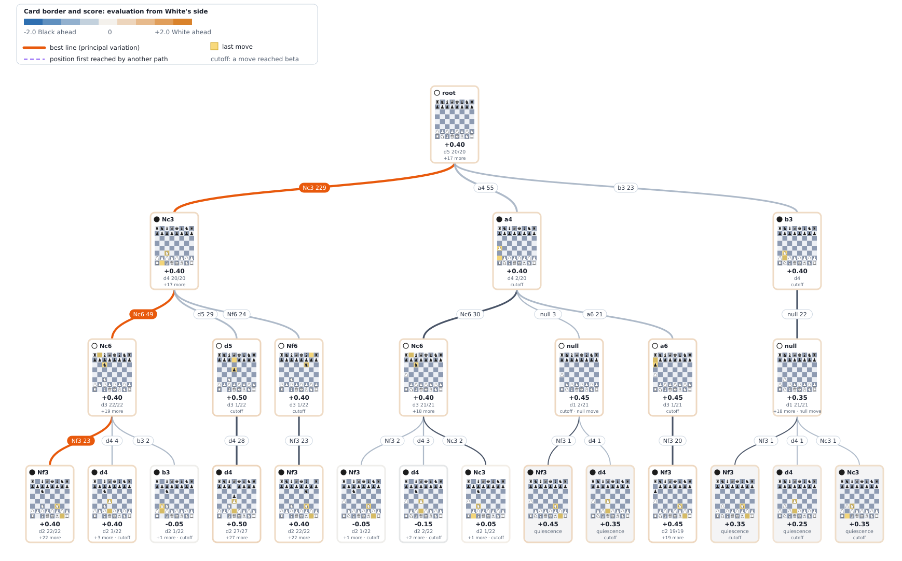

# Meridian

Meridian is a chess engine written in C++. It is the rewrite of Horizon, a desktop game that was
written for a university course project in 2024.

## Architecture

The engine takes a position and returns a move. A position is a FEN string plus the moves played
since. The engine also returns the score of the move. The caller can set a depth limit and a time
limit.

### Board and moves

The engine stores the board as bitboards. A bitboard is a 64-bit number with one bit for each
square. The engine keeps one bitboard for each piece type and color.

Rooks and bishops attack along lines that other pieces can block. The engine finds these attacks
with magic bitboards. One multiplication and one table read give the attacked squares. This is 20
to 30 times faster than walking along each line.

To make a move, the engine copies the position and changes the copy. A Zobrist hash identifies
each position, and every move updates it.

### Search

The engine searches the tree of moves with negamax alpha-beta. It searches in passes. The first
pass has depth 1, and each pass is one ply deeper than the one before. Each pass uses the result
of the previous pass to order the moves, and a move is ready when the time runs out.

At each position, the engine searches the first move with a full window. It searches the other
moves with a window of zero width. If one of them turns out to be better, the engine searches it
again with a full window. This method is called principal variation search.

The engine uses these techniques to search fewer positions:

- **Transposition table.** It stores results by position hash and gives the best move found
  earlier.
- **Null move pruning.** The engine skips its own move. If the position is still good enough, it
  stops searching that position.
- **Late move reductions.** Quiet moves that come late in the order are searched to a smaller
  depth.
- **Reverse futility and futility pruning.** Near the leaves, the engine stops a position whose
  static score is far above beta, and it skips quiet moves that cannot reach alpha.
- **Aspiration windows.** Each pass starts in a window around the score of the pass before it.
- **Check extension.** The engine searches one ply deeper when the side to move is in check.
- **Quiescence search.** At the end of the search, the engine continues with captures. This
  prevents it from stopping in the middle of an exchange. A static exchange evaluation removes
  the captures that lose material.

The order of moves matters for pruning. The engine tries the hash move first. Then it tries
captures that do not lose material, ordered by the value of the captured piece and the value of
the capturing piece. Then it tries the killer moves and the counter move of the move before. Then
it tries the other moves in the order of the history heuristic and of a continuation score.
Captures that lose material come last. A history entry decays in proportion to its size, so that
recent cutoffs count more than old ones.

The engine can draw the search tree as an SVG image or as an interactive page. The image below
shows the tree from the initial position at depth 5. More examples are in
[backend/tree-examples](backend/tree-examples).



### Evaluation

The engine scores a position from material and from the placement of the pieces. Each piece has
a value, and a piece-square table adds a bonus or a penalty for the square the piece stands on.
Four more terms refine the score: the bishop pair, a rook on an open or half-open file, the
number of squares that a knight, bishop, rook or queen can reach, and the right to move.

Every number has a middlegame value and an endgame value, and the score blends the two by the
material left on the board. The numbers were fitted to the results of 695,000 positions from
games of the engine against itself, by a method that minimises the error between the score and
the result of the game (Texel tuning). A term entered the engine only after a match of the
engine with the term against the engine without it.

### Opening book

The server plays its first moves from an opening book, so that games do not repeat. The book is
built by the engine itself: a tool searches the opening tree to depth 12 for both colours,
keeps the moves that score close to the best, and writes them into the library. A move is chosen
at random among the book moves of a position, weighted by score. The book has 39,586 moves for
15,584 positions, and it scores the same as the engine without it (0.496 over 400 games).

### Verification

The tests check the engine in three ways:

- Move generation gives the published perft counts for six reference positions.
- The search solves 1,404 puzzles that ask for mate in one, two or three moves.
- The engine runs under AddressSanitizer and UBSan.

## Performance

The engine improves one technique at a time. A technique stays only if the benchmarks show that
it helps. This section shows those benchmarks.

The benchmark uses fifteen fixed positions: five openings, five middlegames and five endgames.
For each position, the engine searches to a given depth, starting with an empty hash table. The
benchmark records the time and the number of nodes. Each configuration of the search adds one
technique, or one group of techniques, to the previous one.

The benchmark runs on one pinned core of an i9-13900HX. The machine is otherwise idle. Node counts
do not change between runs. The full tables, the method and the raw data are in
[backend/results](backend/results/README.md).

The table shows the mean time per move at depth 3, 5 and 6. Step 00 is the original engine.

| Step | Change | Depth 3 | Depth 5 | Depth 6 |
|---|---|---:|---:|---:|
| 00 | Original desktop engine (does not reach depth 5) | 24,379ms | n/a | n/a |
| 01 | Bitboards, legal moves, plain alpha-beta, rays for sliding pieces | 0.82ms | 136ms | 1,609ms |
| 02 | Magic bitboards for sliding pieces | 0.62ms | 99ms | 1,150ms |
| 03 | Move ordering: captures by victim and attacker, then promotions | 0.18ms | 7.2ms | 29ms |
| 04 | Transposition table | 0.18ms | 7.7ms | 30ms |
| 05 | Quiescence search | 0.59ms | 13ms | 89ms |
| 06 | Iterative deepening and principal variation search | 0.43ms | 5.4ms | 27ms |
| 07 | Null move, late move reductions, killers, history, check extension | 0.51ms | 2.5ms | 5.8ms |
| 08 | Exchange evaluation, futility, aspiration windows, counter moves | 0.25ms | 0.71ms | 1.4ms |
| 09 | Tuned evaluation, tuned margins, history gravity | 0.25ms | 0.96ms | 1.8ms |

Three results stand out:

- Move ordering gives the largest gain after the bitboards. Depth 6 becomes 40 times faster, and
  the value of the search does not change.
- The transposition table does not help a search of fixed depth from an empty table. It helps
  across the passes of iterative deepening and across a whole game.
- Quiescence search is 1.7 to 4 times slower at equal depth. Against the search without it at
  depth 4, it scores 92% of the points (180 wins, 8 draws and 12 losses in 200 games).
- The refinements of step 08 make depth 10 4.7 times faster, from 80ms to 17ms, and the search
  visits 6.5 times fewer positions.
- The tuned evaluation of step 09 is slower per position (133ns for one evaluation against 62ns),
  and it plays much better. It scores 65% of the points against step 08 at 50ms per move (236
  wins, 49 draws, 115 losses in 400 games). Depth 10 takes 19ms.

### Summary

| Measure | Result |
|---|---|
| Depth 10 from an opening position | 34ms on one core |
| Search speed | 2.8 million nodes per second |
| Move generation (perft) | 44 million nodes per second |
| Against step 08 (the engine before the tuning), 50ms per move | 236 wins, 49 draws, 115 losses in 400 games (65.1% of the points) |
| Rating against Stockfish 19, 1s per move | about 2600 Elo (interval 2564 to 2640, 600 games) |

The rating uses Stockfish's `UCI_Elo` scale. Stockfish calibrates this scale for longer time
controls. The number therefore is not a rating-list rating. It applies at this speed and on this
machine.

### Comparison with Stockfish

Per node, the engine is faster than Stockfish. It searches 2.8 million nodes per second.
Stockfish searches 0.6 to 1.6 million nodes per second. Both numbers are measured on one core.

Stockfish needs far fewer nodes to reach a given depth, 23 times fewer at depth 10. Its search is
more selective, and its evaluation is a neural network.

| Depth | Stockfish 19 | This engine | Stockfish nodes | Engine nodes |
|---:|---:|---:|---:|---:|
| 5 | 0.8ms | 0.96ms | 469 | 2,687 |
| 7 | 1.1ms | 3.3ms | 893 | 9,458 |
| 10 | 2.5ms | 19ms | 2,300 | 52,792 |

## Getting started

### Building

```bash
cmake -S backend -B backend/build
cmake --build backend/build -j
```

### Testing

```bash
ctest --test-dir backend/build --output-on-failure
```

## Server

The build also produces `chess_server`, a small HTTP server for the engine. It has two endpoints.
`GET /health` returns the version and the limits. `POST /move` returns the move for a position.
The request can set a depth limit and a time limit, and the server caps both. A request with
`"book": false` skips the opening book.

```bash
backend/build/chess_server        # listens on port 8080
```

The request asks for the best move from the starting position, searched to depth 6.

```bash
curl -s localhost:8080/move -H 'Content-Type: application/json' \
  -d '{"fen": "rnbqkbnr/pppppppp/8/8/8/8/PPPPPPPP/RNBQKBNR w KQkq - 0 1",
       "depth": 6, "book": false}'
```

```json
{"book":false,"depth":6,"elapsed_ms":2.937064,"move":"d2d4","nodes":13296,"score":{"cp":8,"mate":null}}
```

The reply gives the move d2d4 (the pawn from d2 to d4), a score of 8 centipawns, and the work
done: 13,296 nodes in 2.9ms.

The request and reply formats, the environment variables and the limits are in
[backend/README.md](backend/README.md).

## Structure

```bash
.
├── backend         # the engine, its server, tests and benchmarks
│   ├── ...
│   └── README.md
├── CONTRIBUTING.md
├── LICENSE
├── README.md       # This file
└── SECURITY.md
```

[backend/README.md](backend/README.md) describes the engine and its server.

## Roadmap

Quiescence search makes up 57% to 72% of all nodes at depths 5 to 10, and the first move tried
causes the cutoff 94% of the time. The results of the 25 ideas that were tested are in
[backend/results](backend/results/README.md). These remain open.

### Close to a gain

- **Window sized by the variance of the score.** It scored 0.511 over 3,000 games with 9% fewer
  nodes, and it missed one of the 1,404 mate puzzles.
- **Retuning every evaluation group on 1.35 million positions.** It scored 0.574 over 452 games
  and was not kept, because it reports one mate-in-3 puzzle two plies later than the puzzle test
  allows. The engine plays the mating move.
- **Logarithmic reduction table, singular extensions, razoring and internal iterative
  reduction.** None of them reached an answer in 3,000 games. They are candidates for a second
  test on the tuned evaluation.
- **Lazy SMP.** Two threads score 59% of the points against one thread. It needs a deployment
  that gives each request its own cores.

### Infrastructure

- A table of 64MB against 16MB and two-way buckets show no difference at 200ms per move. They
  need a longer time control to be measured.
- SPSA tuning with more games. The 120 iterations of 48 games moved the margins of step 09 and
  gained 13 Elo, so a longer run may give more.
- A build with PEXT lookups, which is 5% to 12% faster, for hosts known to have BMI2.
- Syzygy endgame tablebases. The data files are larger than the memory of the service.

### Evaluation

- A neural evaluation (NNUE) with an incremental accumulator. This is the largest single step
  and the most work.
- Passed pawn and pawn structure terms. They did not pass a match with the numbers that the
  tuning found, and need better starting values or more data.
- A learned move policy. A model of 196 features trained on self-play ordered moves worse than
  history, so it needs better features before another test.

## Provenance

The engine began as a Windows desktop game with a raylib interface. Its rules, search and
evaluation were rewritten as a library, and the interface moved to the web.
[backend/results](backend/results/README.md) records the speed and the rules correctness of the
original engine next to every later step. The table shows the original engine:

| Property of the original engine | Measured |
|---|---|
| Time to search 3 plies | 24s on average, 55s from opening positions |
| Positions visited at depth 3 | 159,004 (plain alpha-beta: 5,849) |
| Perft against published counts | 13 of 24 runs correct (castling and promotion) |
| Move generation | ~70 thousand nodes per second |
| Playing strength at depth 3 | about 1130 on Stockfish's scale (interval 1044 to 1220) |

## Contributing

[CONTRIBUTING.md](CONTRIBUTING.md) describes how to contribute. [SECURITY.md](SECURITY.md)
describes how to report a security problem.

## License

GPL-3.0-or-later, see [LICENSE](LICENSE).
